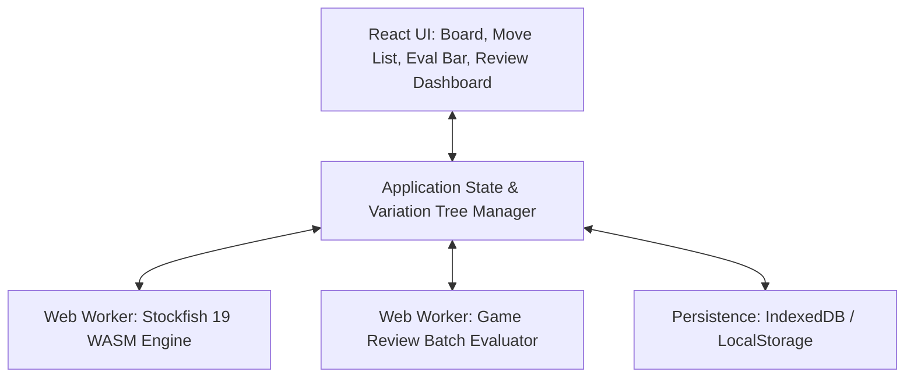

# ChessLab - Project Status & Architecture Documentation

## 1. Project Overview
**ChessLab** is an open-source, client-side chess analysis and game review platform inspired by the analysis tools of Chess.com and Lichess. It runs entirely inside the browser without requiring external servers, subscriptions, or paid APIs.

### Hardware Target
- **Target Profile:** Windows 11, Intel Core i3 12th Gen, 8GB RAM, Integrated Graphics.
- **Optimization Strategy:**
  - Dedicated single-threaded Web Worker for Stockfish 19 WASM (prevents thread contention and memory bloat on 8GB RAM).
  - Low default hash memory (16MB, configurable up to 64MB).
  - Search throttling and instant cancellation on position change to avoid stale calculations.
  - Pure SVG/Canvas UI rendering and lightweight reactive state (zero layout thrashing).
  - IndexedDB for large game storage; LocalStorage for UI preferences.

---

## 2. Technology Stack & Licensing
| Component | Technology | Purpose & Licensing |
| :--- | :--- | :--- |
| **Frontend Framework** | React 18 + TypeScript | UI architecture, type safety, modular component lifecycle |
| **Build Tool** | Vite | Instant HMR, optimized ES-module bundling |
| **Styling** | Tailwind CSS | Sleek dark-mode aesthetic inspired by Chess.com slate/charcoal palettes |
| **Icons** | Lucide React | Clean, lightweight UI icons |
| **Chess Engine / Rules** | `chess.js` | Move validation, legal move generation, FEN/PGN handling, draw/check detection |
| **Board UI** | `react-chessboard` | Interactive board supporting drag-and-drop, click-to-move, arrow overlays |
| **Engine** | Stockfish 19 WASM | Official release Stockfish 19 WASM with UCI protocol (GPL-3.0 License) |
| **Concurrency** | HTML5 Web Workers | Isolates engine computation and batch game reviews from UI thread |
| **Storage** | IndexedDB / LocalStorage | Offline persistence of imported games, analysis trees, and settings |
| **Testing** | Vitest + React Testing Library | Unit tests for chess logic, review engine, and UCI controller |

---

## 3. Architecture & Data Flow

### Key Subsystems:
1. **Engine Controller (`/src/services/engine/`):**
   - Spawns and manages the Stockfish 19 Web Worker.
   - Verifies UCI identification (`id name Stockfish 19`).
   - Implements strict search queueing with `stop` and `isready` synchronization to prevent stale evaluations.
   - Configurable Depth (default 16 for responsive i3 performance) and MultiPV (1 to 5).
2. **Variation Tree Engine (`/src/services/tree/`):**
   - Non-destructive DAG (Directed Acyclic Graph) of moves.
   - Allows branching from any move, sub-variations, variation promotion to mainline, and deletion.
   - Preserves original imported game without accidental overwrites.
3. **Game Review Engine (`/src/services/review/`):**
   - Sequential position evaluator using Stockfish 19.
   - Move classification based on Centipawn Loss (CPL) and Win Probability ($\Delta Win\%$).
   - Documented White & Black Accuracy calculation.
   - Chess-position based Game Phase Detection (Opening, Middlegame, Endgame).
   - Estimated Performance ELO with confidence range and explicit disclaimers.

---

## 4. Implementation Milestones

- [x] **Milestone 1: Project Scaffolding & Foundational Setup**
  - Project configuration: Vite, React, TypeScript, Tailwind CSS, Lucide icons, Vitest.
  - Base layout shell with responsive panels (Board, Sidebar, Evaluation Bar placeholder).
  - Verified compilation and test runner.
- [x] **Milestone 2: Stockfish 19 WASM Integration & Engine Service**
  - Web Worker loader for Stockfish 19 WASM.
  - UCI protocol handler, engine version verification, search cancellation & throttling.
  - Depth & MultiPV controls, GPL-3.0 license notices.
- [x] **Milestone 3: Interactive Analysis Board & Mainline Navigation**
  - Move validation with `chess.js`, legal move highlighting, drag-and-drop & click-to-move.
  - Castling, en passant, pawn promotion dialog.
  - Move history navigation (first, prev, next, last, flip, undo/redo).
  - PGN & FEN import/export dialogs with input validation.
- [x] **Milestone 4: Variation Tree & Branching Explorer**
  - Poly-tree data structure supporting branching from any node.
  - Nested variation viewer, promote variation, delete branch.
  - Real-time engine analysis on any branch position.
- [x] **Milestone 5: Real-time Evaluation Bar, Graph & Best-Move Arrows**
  - Dynamic evaluation bar with centipawn & mate-in-N display.
  - Interactive evaluation graph across all game moves.
  - Visual best-move arrow overlays for top MultiPV lines.
- [x] **Milestone 6: Game Review Engine & Move Classification**
  - Automated batch review with progress bar and cancellation.
  - Transparent move classifications (Brilliant, Great, Best, Excellent, Good, Inaccuracy, Mistake, Blunder, Missed Win).
  - Accuracy calculation and move-by-move breakdown.
  - Position-based Game Phase Detection & Performance ELO estimator.
- [x] **Milestone 7: Game Statistics, Library & Local Persistence**
  - Persistent IndexedDB storage for games, variation trees, annotations, and completed review reports.
  - Automatic workspace debounced save & restoration on application refresh/reload.
  - Dedicated Library tab: search, filter by result/review status, sort, rename, duplicate, and delete with modal confirmation.
  - Multi-game PGN import and batch PGN export.
  - Full JSON backup export and restore with safe merge vs overwrite modes.
  - Dedicated Stats tab: win rate %, White & Black avg accuracy, ACPL, total moves analyzed, classification counts, and phase performance.
- [x] **Milestone 8: Hardware Optimization, Hardening & Security Audit**
  - Profiling and tuning for modest hardware (Intel Core i3 12th Gen, 8GB RAM, integrated graphics).
  - Single-threaded Web Worker architecture without SharedArrayBuffer overhead.
  - Resource protection: tab visibility listener (`visibilitychange`) pauses engine searches in background tabs; `beforeunload` ensures clean worker termination.
  - XSS hardening via React escaping (zero `dangerouslySetInnerHTML`), strict CSP, sanitized PGN import, 15MB file size limits, and 1,000-game batch caps.
  - Keyboard navigation shortcuts (`←`, `→`, `↑`, `↓`, `F` to flip) and complete settings panel with engine attribution & disclaimers.
  - Complete automated test suite: 106 tests across 17 suites passing cleanly. Clean production build in 6.18s.

---

## 5. Completed Work Log
| Date | Milestone | Notes |
| :--- | :--- | :--- |
| 2026-11-13 | Initial Planning | Folder inspected (empty). Documented architecture, hardware constraints, and roadmap. |
| 2026-11-13 | Milestone 1: Scaffolding | Initialized Vite + React 18 + TypeScript + Tailwind CSS. Installed Stockfish 19 & dependencies. Test runner and production build verified. |
| 2026-11-13 | Milestone 2: Engine Service | Implemented Stockfish 19 Web Worker service, UCI parser, White-relative conversion, search cancellation queue, and MultiPV (1-5). Verified with 19 passing Vitest tests and successful build. |
| 2026-11-13 | Milestone 3: Interactive Board | Integrated react-chessboard & chess.js: drag-and-drop, click-to-move, pawn promotion dialog, check/mate detection, PGN/FEN modal, keyboard arrow navigation, and real-time Stockfish 19 analysis sync. Verified with 32 passing Vitest tests and successful production build. |
| 2026-11-13 | Milestone 4: Variation Tree | Built true Poly-Tree data structure supporting non-destructive multi-branching from any ply, variation promotion to mainline, branch deletion with confirmation modal, move comments and NAG glyphs, 1-click engine candidate moves into branches, and standard PGN RAV variation import/export. Verified with 40 passing Vitest tests and clean build. |
| 2026-11-13 | Milestone 5: Visual Analysis | Built responsive EvaluationBar with logistic win curve, interactive EvaluationGraph with click navigation across real Stockfish evaluations, LRU position evaluation cache (EvalCache), on-board best-move arrow overlays for MultiPV lines, and SAN formatting for principal variations. Verified with 52 passing Vitest tests and successful build. |
| 2026-11-13 | Milestone 6: Game Review Engine | Built automated Game Review engine with Stockfish 19: sequential move evaluation with live progress bar and cancellation; transparent 9-tier move classification (Brilliant, Great, Best, Excellent, Good, Inaccuracy, Mistake, Blunder, Missed Win); exponential win rate delta accuracy formula ($Accuracy = 100 \times e^{-0.045 \times \Delta Win\%}$); piece-count game phase detector (Opening, Middlegame, Endgame); estimated Performance Elo calculator with explicit confidence disclaimers; and comprehensive GameReviewDashboard UI with filter pills (All, Key Moments, White, Black) and interactive board navigation. Verified with 78 passing Vitest tests and clean production build. |
| 2026-11-13 | Milestone 7: Library & Persistence | Implemented client-side IndexedDB persistence engine (`chesslab_db` v1) with versioning; debounced workspace auto-save and seamless restore on page reload; dedicated GameLibraryView with search, result/review filters, sorting, duplication, deletion modal, and multi-game PGN import/export; JSON backup export & restore with safe merge/overwrite modes; dedicated GameStatsDashboard with win rate %, White & Black avg accuracy, ACPL, move classification aggregation, phase accuracy breakdown, and recent reviewed game history. Verified with 106 passing Vitest tests and clean production build. |
| 2026-11-13 | Milestone 8: Hardening & Polish | Completed performance profiling for 8GB RAM/i3 hardware: single-threaded Stockfish 19 WASM, tab visibility resource conservation, 150ms search debounce, beforeunload worker termination, strict CSP, XSS audit (0 dangerouslySetInnerHTML), 15MB file upload limit, QuotaExceededError handling, keyboard shortcuts (Arrow keys + 'F'), comprehensive documentation (README.md), and UI polish. 106 automated tests passing across 17 test files and 100% clean production build. |
| 2026-11-13 | Analysis Accuracy Overhaul | Executed comprehensive Game Analysis Accuracy Overhaul: audited and fixed CPL calculations with strict Best-Move Invariance ($CPL = 0$) and perspective conversion; integrated CC0/Public Domain ECO opening theory database for genuine 'Book' classifications; implemented tactical sacrifice heuristics for 'Brilliant (!!)' and candidate gap/pressure hold heuristics for 'Great (!)'; added classification badges beside SAN in MoveHistory for every turn; created dedicated CurrentMovePanel near board showing played move, badge, engine recommendation, and eval change; added configurable review depths (12, 14, 16, 18 ply); enhanced EvalCache to prevent shallow evaluation reuse; and added 18 benchmark tests covering blunders, missed tactical opportunities, forced moves, sacrifices, quiet moves, and opening theory. 125 automated tests passing across 18 test files and 100% clean production build. |
